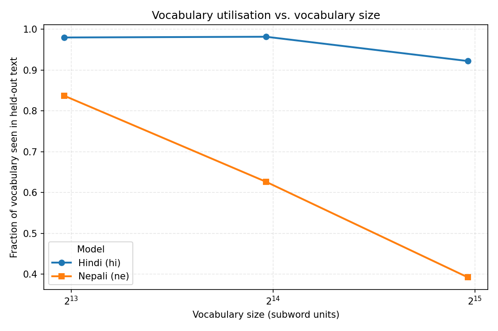

# Phase 1 — Data Collection and Tokenizer Construction

Language Models and Agents, Monsoon 2026 — Individual Project

All figures in this report are generated from the `_stats.json` and `sweep.json` files written by the pipeline stages; none are typed by hand. Regenerate with `python -m common.report.phase1`.

## 1. Language selection

| Model | Language | Tier | Script |
|---|---|---|---|
| Model H | Hindi (`hi`) | higher-resource, non-English Indian | Devanagari |
| Model L | Nepali (`ne`) | lower-resource (from the permitted list) | Devanagari |

**Why Hindi.** It has the largest volume of freely available, openly licensed Devanagari text of any Indian language: a large Wikipedia, a very large Wikisource of public-domain literature, and an active online press.

**Why Nepali, and not Bhojpuri or Maithili.** Nepali shares the Devanagari script with Hindi, so a single normalisation pipeline serves both models, but it is linguistically distant enough from Hindi that the two are reliably separable. Bhojpuri and Maithili sit inside the Hindi dialect continuum, are often recorded as Hindi, and are routinely confused with it by language-ID models; text labelled as either is frequently Hindi in practice. Since the brief requires the two corpora to share no data, that contamination risk was judged more damaging than the smaller resource gap Nepali gives.

Because both models use Devanagari, the same script-ratio filter (at least 60% Devanagari letters) guards both corpora, and the same Unicode normalisation applies to each.

## 2. Corpora

### 2.1 Hindi — Model H (higher-resource)

**Final corpus: 257,258 documents, 537,900,437 characters, approximately 153,685,839 tokens (100.0% manually collected).**

#### Sources

| Source | Description | Collection | Documents in | Kept after filters |
|---|---|---|---|---|
| `hiwikisource` | Wikisource proofread pages (public-domain literature) | manual | 160,558 | 156,997 |
| `hiwiki` | Wikipedia article dump | manual | 87,043 | 86,747 |
| `livehindustan` | Live Hindustan news, own crawler | manual | 8,311 | 8,309 |
| `navbharattimes` | Navbharat Times news, own crawler | manual | 4,499 | 4,495 |
| `jagran` | Jagran news, own crawler | manual | 2,789 | 2,787 |
| `hiwikibooks` | Wikibooks dump | manual | 2,075 | 2,067 |
| `hiwikiquote` | Wikiquote dump | manual | 1,210 | 1,209 |
| `hiwikiversity` | Wikiversity dump | manual | 225 | 225 |

#### Cleaning and deduplication

| Stage | Documents removed | Remaining |
|---|---|---|
| Loaded from interim | -- | 266,710 |
| Quality filter: below minimum length | 1 | |
| Quality filter: too few words | 47 | |
| Quality filter: digit-dominated | 282 | |
| Quality filter: punctuation-dominated | 3,531 | |
| Quality filter: repetitive lines (listing pages) | 13 | |
| **After normalisation and quality filters** | | **262,836** |
| Exact duplicates (SHA-256 of normalised text) | 146 | |
| Near-duplicates (MinHash/LSH, 2,034 clusters) | 5,432 | |
| **Final corpus** | | **257,258** |

#### Splits

Splits are assigned per document from a salted SHA-256 of the document id, never per line, so no article contributes to more than one split. Because the assignment is a pure function of the id, adding a new source later leaves every existing document in the split it already had.

| Split | Documents | Characters | Est. tokens | Manual (char %) |
|---|---|---|---|---|
| train | 252,069 | 526,781,839 | 150,509,096 | 100.0% |
| validation | 2,501 | 5,267,335 | 1,504,952 | 100.0% |
| test | 2,688 | 5,851,263 | 1,671,789 | 100.0% |
| **total** | **257,258** | **537,900,437** | **153,685,839** | **100.0%** |

### 2.2 Nepali — Model L (lower-resource)

**Final corpus: 22,023 documents, 44,503,616 characters, approximately 12,715,318 tokens (100.0% manually collected).**

#### Sources

| Source | Description | Collection | Documents in | Kept after filters |
|---|---|---|---|---|
| `newiki` | Wikipedia article dump | manual | 21,878 | 21,870 |
| `nagariknews` | Nagarik News, own crawler | manual | 2,718 | 2,699 |
| `ratopati` | Ratopati news, own crawler | manual | 1,000 | 999 |

#### Cleaning and deduplication

| Stage | Documents removed | Remaining |
|---|---|---|
| Loaded from interim | -- | 25,596 |
| Quality filter: below minimum length | 2 | |
| Quality filter: punctuation-dominated | 25 | |
| Quality filter: repetitive lines (listing pages) | 1 | |
| **After normalisation and quality filters** | | **25,568** |
| Exact duplicates (SHA-256 of normalised text) | 1,796 | |
| Near-duplicates (MinHash/LSH, 334 clusters) | 1,749 | |
| **Final corpus** | | **22,023** |

#### Splits

Splits are assigned per document from a salted SHA-256 of the document id, never per line, so no article contributes to more than one split. Because the assignment is a pure function of the id, adding a new source later leaves every existing document in the split it already had.

| Split | Documents | Characters | Est. tokens | Manual (char %) |
|---|---|---|---|---|
| train | 21,604 | 43,765,730 | 12,504,494 | 100.0% |
| validation | 211 | 397,761 | 113,646 | 100.0% |
| test | 208 | 340,125 | 97,178 | 100.0% |
| **total** | **22,023** | **44,503,616** | **12,715,318** | **100.0%** |

## 3. Preprocessing

The two languages run the same code over separate data. No document, tokenizer, or vocabulary is shared between them.

**Collection.** Wikimedia dumps are parsed with a streaming reader (`common/wiki/`); news sites are discovered from sitemaps, RSS feeds, or a polite crawler and fetched with `common/scrape/`, honouring `robots.txt` and each site's declared `Crawl-delay`. Raw bytes are stored unmodified so that extraction can be re-run without re-fetching.

**Normalisation** (`common/pipeline/normalize.py`):

1. Unicode NFC. This matters for Devanagari because the precomposed nukta letters U+0958–U+095F are on Unicode's composition-exclusion list, so NFC decomposes them consistently into base letter plus U+093C. Corpora contain both spellings; after NFC they are one.

2. Zero-width joiner and non-joiner removal. These are invisible, applied inconsistently across sources, and split otherwise identical words.

3. **Devanagari matra repair.** Some legacy Nepali input methods write the vowel sign O as AA + E (U+093E U+0947) rather than U+094B, and AU as AA + AI. These render almost identically and survive proofreading unnoticed. Unicode normalisation does *not* fix them: U+094B has no canonical decomposition, so the two forms are simply different strings, not canonically equivalent ones. Left alone, the highly frequent Nepali morpheme को is split into two unrelated token sequences, so an explicit repair table is applied.

4. Boilerplate line removal, including machine-generated article summaries found on one Nepali outlet.

5. URL and e-mail stripping, and whitespace collapsing.

**Quality filters** reject a document and record *why*, so the cleaning table above shows which filter removed how much: length bounds, minimum word count, at least 60% Devanagari letters, digit and punctuation ratio caps, and a repeated-line check that catches listing pages.

**Deduplication** runs at two levels. Exact duplicates are found by SHA-256 of the normalised text. Near-duplicates use 128-permutation MinHash signatures over 5-word shingles, indexed with LSH in 16 bands of 8 rows (a similarity threshold near 0.76), with clusters merged by union-find.

When a duplicate cluster is collapsed, **the manually collected copy is kept in preference to a downloaded one**. This is deliberate: downloaded corpora such as CC-100 are built from Common Crawl, which crawled Wikipedia, so a manually parsed article and a downloaded copy of it are near-duplicates. If the downloaded copy won, the document would silently change from manual to downloaded and the manual fraction required by the brief would erode with no error raised. The manual fraction is therefore reported *after* dedup.

## 4. Tokenizers

One tokenizer per language, trained from scratch with SentencePiece (unigram) on that language's **training split only**, so no held-out text influences the vocabulary. Vocabularies are not shared and may differ in size.

`byte_fallback` is enabled, so any unseen character decomposes into UTF-8 bytes rather than producing `<unk>`. The unknown-token rate is therefore zero by construction, and the meaningful diagnostic is the **byte-fallback rate** reported below.

### 4.1 Hindi

| Vocab size | Fertility (tok/word) | Chars/token | Unknown rate | Byte-fallback rate | Vocab utilisation |
|---|---|---|---|---|---|
| 8,000 | 1.556 | 3.38 | 0.00e+00 | 3.14e-03 | 98.0% |
| 16,000 | 1.428 | 3.68 | 0.00e+00 | 3.42e-03 | 98.2% |
| 32,000 | 1.344 | 3.91 | 0.00e+00 | 3.63e-03 | 92.2% |

Most frequent held-out tokens: `।`, `▁के`, `,`, `▁है`, `▁में`, `▁की`, `▁और`, `▁से`, `▁का`, `-`, `▁को`, `▁।`, `▁हैं`, `▁(`, `▁पर`

**Example segmentations**

- **19 words -> 23 tokens** (fertility 1.211):
  - text: `अटापट्टू की कप्तानी में उतरेगी श्रीलंकाई टीम, एशिया कप का खिताब बचाने के लिए 15 सदस्यीय टीम का एलान`
  - pieces: `▁अटा प ट्टू ▁की ▁कप्तानी ▁में ▁उतरे गी ▁श्रीलंकाई ▁टीम , ▁एशिया ▁कप ▁का ▁खिताब ▁बचाने ▁के ▁लिए ▁15 ▁सदस्यीय ▁टीम ▁का ▁एलान`

- **19 words -> 24 tokens** (fertility 1.263):
  - text: `पंजाब के खेतों से निकल शादी-पार्टियों की शान बना भांगड़ा, दिलचस्प है इस लोकनृत्य के शुरू होने की कहानी`
  - pieces: `▁पंजाब ▁के ▁खेतों ▁से ▁निकल ▁शादी - पार्ट ियों ▁की ▁शान ▁बना ▁भांग ड़ा , ▁दिलचस्प ▁है ▁इस ▁लोकनृत्य ▁के ▁शुरू ▁होने ▁की ▁कहानी`

- **18 words -> 24 tokens** (fertility 1.333):
  - text: `सामुद्रिक शास्त्र: पीठ के बल सोना या करवट लेना? आपकी 'स्लीप पोजीशन' में छिपे हैं भविष्य के संकेत`
  - pieces: `▁सामुद्रिक ▁शास्त्र : ▁पीठ ▁के ▁बल ▁सोना ▁या ▁कर वट ▁लेना ? ▁आपकी ▁' स्ली प ▁पोजीशन ' ▁में ▁छिपे ▁हैं ▁भविष्य ▁के ▁संकेत`

### 4.2 Nepali

| Vocab size | Fertility (tok/word) | Chars/token | Unknown rate | Byte-fallback rate | Vocab utilisation |
|---|---|---|---|---|---|
| 8,000 | 1.689 | 3.95 | 0.00e+00 | 2.42e-03 | 83.7% |
| 16,000 | 1.540 | 4.33 | 0.00e+00 | 2.65e-03 | 62.6% |
| 32,000 | 1.442 | 4.63 | 0.00e+00 | 2.83e-03 | 39.2% |

Most frequent held-out tokens: `।`, `,`, `को`, `▁र`, `मा`, `ले`, `▁।`, `का`, `▁थियो`, `▁छ`, `लाई`, `▁(`, `▁मा`, `▁हो`, `)`

**Example segmentations**

- **22 words -> 50 tokens** (fertility 2.273):
  - text: `आजकाे कार्टुनमा 'पर्सा जिल्ला अदालतले पनि माग्याे लामिछानेसँग कराेड धराैटी! लाै, जेन-जी सरकारले पनि प्रतिशाेध साँधेछ?' भ`
  - pieces: `▁आज का े ▁कार्टुन मा ▁' पर्स ा ▁जिल्ला ▁अदालतले ▁पनि ▁मा ग्या े ▁लामिछाने सँग ▁करा ेड ▁ धरा ै टी ! ▁ला ै , ▁जेन - जी ▁सरकारले ▁पनि ▁प्रति शा े ध ▁साँध े छ ?' ▁भनेर`

- **31 words -> 40 tokens** (fertility 1.29):
  - text: `एनसेलले एनसेल बिजनेस क्लाउडसुइट सेवा सुरु गरेको छ। यो स्थानीय रूपमा समर्थित प्लेटफर्म हो जसले डोमेन दर्ता र व्यावसायिक व`
  - pieces: `▁एनसेल ले ▁एनसेल ▁बिजनेस ▁क्लाउड सु इट ▁सेवा ▁सुरु ▁गरेको ▁छ । ▁यो ▁स्थानीय ▁रूपमा ▁समर्थित ▁प्लेटफर्म ▁हो ▁जसले ▁डोमेन ▁दर्ता ▁र ▁व्यावसायिक ▁वेब ▁होस्टिङ ▁सेवा ▁एकै ▁ठाउँमा ▁उपलब्ध ▁गराउँछ । ▁यो ▁सेवा ▁नेपाल भरि का ▁व्यवसाय , ▁स्टार्टअप ,`

- **30 words -> 40 tokens** (fertility 1.333):
  - text: `सामाजिक सञ्जालमाथिको प्रतिबन्ध फुकुवा र भ्रष्टाचारको समूल अन्त्य गर्ने नारासाथ भदौ २३ र २४ गते भएको प्रदर्शनले हिंसात्मक`
  - pieces: `▁सामाजिक ▁सञ्जाल माथि को ▁प्रतिबन्ध ▁फुकुवा ▁र ▁भ्रष्टाचार को ▁स मूल ▁अन्त्य ▁गर्ने ▁नारा साथ ▁भदौ ▁२३ ▁र ▁२४ ▁गते ▁भएको ▁प्रदर्शन ले ▁ हिंसात्मक ▁रूप ▁लिँदा ▁धेरै ▁व्यक्तिको ▁हताहत ी ▁र ▁राष्ट्रिय ▁सम्पदा को ▁विनाश ▁भयो । ▁निश्चित ▁राजनीति`

### 4.3 Model H vs. Model L, side by side

| Vocab size | Hindi fertility | Hindi utilisation | Nepali fertility | Nepali utilisation |
|---|---|---|---|---|
| 8,000 | 1.556 | 98.0% | 1.689 | 83.7% |
| 16,000 | 1.428 | 98.2% | 1.540 | 62.6% |
| 32,000 | 1.344 | 92.2% | 1.442 | 39.2% |

Two things are visible here, and they are the clearest quantitative evidence of the resource gap that this project is about.

**Hindi has lower fertility at every vocabulary size.** A tokenizer fitted on more text learns more useful merges, so the same amount of language costs fewer tokens. Model L therefore fits less real content into an identical context window, before any architectural difference is considered.

**Vocabulary utilisation separates the two far more sharply than fertility does.** Hindi keeps 92-98% of its vocabulary in use on held-out text across the whole sweep, so it can afford a large vocabulary. Nepali falls from 84% at 8k to 39% at 32k: three-fifths of a 32,000-entry Nepali vocabulary never appears in held-out text at all. Those entries would still consume embedding parameters in Phase 2 while receiving almost no gradient signal.

This is why fertility alone is not a sufficient selection criterion, and why the two models are given different vocabulary sizes rather than a single shared setting.

### 4.4 Choosing the vocabulary size

Fertility falls monotonically as the vocabulary grows, so fertility alone would always argue for the largest vocabulary. Two things argue against it.

First, **vocabulary utilisation** — the fraction of the vocabulary that actually occurs in held-out text — falls sharply with size. Entries that appear rarely receive poorly estimated embeddings during pretraining.

Second, the Phase 2 budget is roughly 25M parameters. With a model dimension of 384 and tied embeddings, a 32,000-entry vocabulary consumes 32,000 × 384 ≈ 12.3M parameters — about half the entire budget — while a 16,000-entry vocabulary costs half that and leaves the parameters for transformer blocks instead.

**Chosen sizes.**

| Model | Vocabulary | Fertility | Utilisation | Embedding params at d=384 | Reason |
|---|---|---|---|---|---|
| Model H (Hindi) | **16,000** | 1.428 | 98.2% | 6.1M | Utilisation is at its peak and fertility is within 6% of the 32k value, for half the embedding cost. 32k would spend 12.3M of the ~25M Phase 2 budget on the embedding table alone. |
| Model L (Nepali) | **8,000** | 1.689 | 83.7% | 3.1M | The only size where most of the vocabulary is actually exercised by held-out text. At 16k utilisation is already 62.6% and at 32k only 39.2%, so the extra entries would be embedding parameters trained on almost nothing. |

The asymmetry is the intended outcome, not an inconsistency: the lower-resource corpus supports a smaller vocabulary. These choices are recorded in `Hindi/configs/tokenizer.yaml` and `Nepali/configs/tokenizer.yaml` for Phase 2, and the trade-off is plotted in `report/figures/tokenizer_fertility.png` and `report/figures/tokenizer_vocab_utilisation.png`.

## 5. Figures

## 6. Reproduction

See the repository `README.md` for the full command sequence and the Google Drive links to the datasets and tokenizer artifacts.
