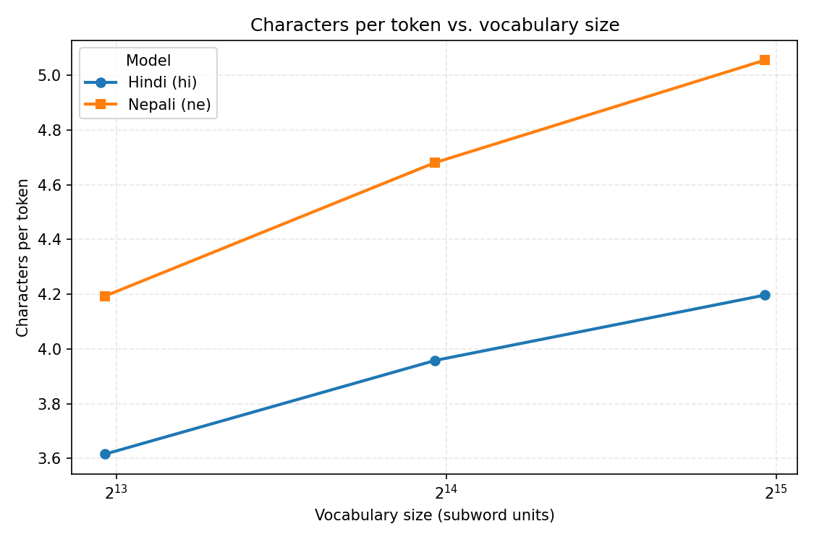
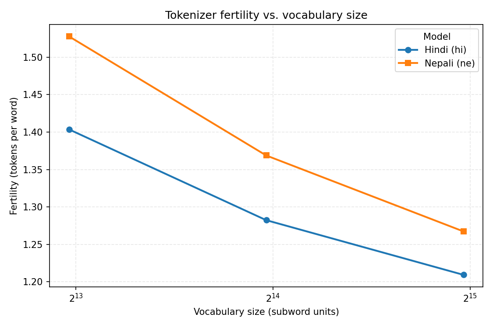
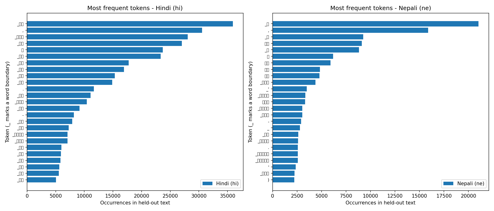

# Phase 1 — Data Collection and Tokenizer Construction

Language Models and Agents, Monsoon 2026 — Individual Project

All figures in this report are generated from the `_stats.json` and `sweep.json` files written by the pipeline stages; none are typed by hand. Regenerate with `python -m common.report.phase1`.

## 1. Language selection

| Model | Language | Tier | Script |
|---|---|---|---|
| Model H | Hindi (`hi`) | higher-resource, non-English Indian | Devanagari |
| Model L | Nepali (`ne`) | lower-resource (from the permitted list) | Devanagari |

**Why Hindi.** It has the largest volume of freely available, openly licensed Devanagari text of any Indian language: a large Wikipedia, a very large Wikisource of public-domain literature, and an active online press.

**Why Nepali, and not Bhojpuri or Maithili.** Nepali shares the Devanagari script with Hindi, so a single normalisation pipeline serves both models, but it is linguistically distant enough from Hindi that the two are reliably separable. Bhojpuri and Maithili sit inside the Hindi dialect continuum, are often recorded as Hindi, and are routinely confused with it by language-ID models; text labelled as either is frequently Hindi in practice. Since the brief requires the two corpora to share no data, that contamination risk was judged more damaging than the smaller resource gap Nepali gives.

Because both models use Devanagari, the same script-ratio filter (at least 60% Devanagari letters) guards both corpora, and the same Unicode normalisation applies to each.

## 2. Corpora

### 2.1 Hindi — Model H (higher-resource)

**Final corpus: 870,914 documents, 2,062,310,348 characters, 534,224,147 tokens (28.1% manually collected).**

#### Sources

| Source | Description | Collection | Documents in | Kept after filters |
|---|---|---|---|---|
| `cc100_hi` | CC-100 (pre-built public corpus) | downloaded | 487,850 | 487,247 |
| `sangraha_hi` | Sangraha verified (pre-built public corpus) | downloaded | 182,193 | 182,062 |
| `hiwikisource` | Wikisource proofread pages (public-domain literature) | manual | 160,558 | 156,997 |
| `hiwiki` | Wikipedia article dump | manual | 87,043 | 86,747 |
| `livehindustan` | Live Hindustan news, own crawler | manual | 33,423 | 33,421 |
| `navbharattimes` | Navbharat Times news, own crawler | manual | 4,499 | 4,495 |
| `jagran` | Jagran news, own crawler | manual | 2,789 | 2,787 |
| `hiwikibooks` | Wikibooks dump | manual | 2,075 | 2,067 |
| `hiwikiquote` | Wikiquote dump | manual | 1,210 | 1,209 |
| `hiwikiversity` | Wikiversity dump | manual | 225 | 225 |

#### Cleaning and deduplication

| Stage | Documents removed | Remaining |
|---|---|---|
| Loaded from interim | -- | 961,865 |
| Quality filter: below minimum length | 9 | |
| Quality filter: above maximum length | 7 | |
| Quality filter: too few words | 62 | |
| Quality filter: digit-dominated | 283 | |
| Quality filter: punctuation-dominated | 4,212 | |
| Quality filter: repetitive lines (listing pages) | 35 | |
| **After normalisation and quality filters** | | **957,257** |
| Exact duplicates (SHA-256 of normalised text) | 27,269 | |
| Near-duplicates (MinHash/LSH, 16,605 clusters) | 59,074 | |
| **Final corpus** | | **870,914** |

#### Splits

Splits are assigned per document from a salted SHA-256 of the document id, never per line, so no article contributes to more than one split. Because the assignment is a pure function of the id, adding a new source later leaves every existing document in the split it already had.

| Split | Documents | Characters | Tokens | Manual (char %) |
|---|---|---|---|---|
| train | 853,623 | 2,021,507,508 | 523,670,863 | 28.1% |
| validation | 8,544 | 20,211,359 | 5,237,540 | 27.9% |
| test | 8,747 | 20,591,481 | 5,315,744 | 29.9% |
| **total** | **870,914** | **2,062,310,348** | **534,224,147** | **28.1%** |

Token counts are measured by encoding every document with this language's chosen 16,000-entry tokenizer, not estimated from a characters-per-token constant (3.8604 for this corpus).

### 2.2 Nepali — Model L (lower-resource)

**Final corpus: 883,371 documents, 1,702,940,920 characters, 364,716,006 tokens (22.9% manually collected).**

#### Sources

| Source | Description | Collection | Documents in | Kept after filters |
|---|---|---|---|---|
| `sangraha_ne` | Sangraha verified (pre-built public corpus) | downloaded | 414,049 | 413,986 |
| `cc100_ne` | CC-100 (pre-built public corpus) | downloaded | 346,720 | 346,272 |
| `khabarhub` | Khabarhub news, own crawler (sitemap-driven) | manual | 56,902 | 56,895 |
| `onlinekhabar` | Online Khabar news, own crawler | manual | 30,291 | 30,290 |
| `makalukhabar` | Makalu Khabar, own crawler (sitemap-driven) | manual | 30,145 | 30,139 |
| `newiki` | Wikipedia article dump | manual | 21,878 | 21,870 |
| `deshsanchar` | Desh Sanchar, own crawler (sitemap-driven) | manual | 21,100 | 20,896 |
| `hamrakura` | Hamrakura news, own crawler | manual | 12,241 | 12,206 |
| `bizmandu` | Bizmandu (business), own crawler | manual | 11,428 | 11,426 |
| `baahrakhari` | Baahrakhari news, own crawler | manual | 4,510 | 4,468 |
| `swasthyakhabar` | Swasthya Khabar (health), own crawler | manual | 3,382 | 3,375 |
| `nagariknews` | Nagarik News, own crawler | manual | 3,191 | 3,170 |
| `setopati` | Setopati news, own crawler | manual | 3,013 | 3,010 |
| `ratopati` | Ratopati news, own crawler | manual | 2,180 | 2,177 |
| `ekantipur` | eKantipur news, own crawler | manual | 2,135 | 2,135 |
| `pahilopost` | Pahilo Post, own crawler | manual | 1,764 | 1,764 |
| `thahakhabar` | Thaha Khabar, own crawler | manual | 1,600 | 1,592 |
| `ujyaaloonline` | Ujyaalo Online news, own crawler | manual | 1,512 | 1,512 |
| `gorkhapatra` | Gorkhapatra (state daily), own crawler | manual | 1,329 | 1,317 |
| `sajhapost` | Sajha Post, own crawler | manual | 1,329 | 1,326 |
| `newiktionary` | Wiktionary dump (definition prose) | manual | 857 | 845 |
| `nayapatrika` | Naya Patrika, own crawler | manual | 232 | 232 |
| `newikibooks` | Wikibooks dump | manual | 168 | 168 |

#### Cleaning and deduplication

| Stage | Documents removed | Remaining |
|---|---|---|
| Loaded from interim | -- | 971,956 |
| Quality filter: below minimum length | 289 | |
| Quality filter: too few words | 38 | |
| Quality filter: digit-dominated | 31 | |
| Quality filter: punctuation-dominated | 515 | |
| Quality filter: repetitive lines (listing pages) | 12 | |
| **After normalisation and quality filters** | | **971,071** |
| Exact duplicates (SHA-256 of normalised text) | 19,457 | |
| Near-duplicates (MinHash/LSH, 32,378 clusters) | 68,243 | |
| **Final corpus** | | **883,371** |

#### Splits

Splits are assigned per document from a salted SHA-256 of the document id, never per line, so no article contributes to more than one split. Because the assignment is a pure function of the id, adding a new source later leaves every existing document in the split it already had.

| Split | Documents | Characters | Tokens | Manual (char %) |
|---|---|---|---|---|
| train | 865,795 | 1,669,078,931 | 357,473,575 | 22.9% |
| validation | 8,856 | 17,185,446 | 3,677,138 | 24.8% |
| test | 8,720 | 16,676,543 | 3,565,293 | 23.8% |
| **total** | **883,371** | **1,702,940,920** | **364,716,006** | **22.9%** |

Token counts are measured by encoding every document with this language's chosen 16,000-entry tokenizer, not estimated from a characters-per-token constant (4.6692 for this corpus).

## 3. Preprocessing

The two languages run the same code over separate data. No document, tokenizer, or vocabulary is shared between them.

**Collection.** Wikimedia dumps are parsed with a streaming reader (`common/wiki/`); news sites are discovered from sitemaps, RSS feeds, or a polite crawler and fetched with `common/scrape/`, honouring `robots.txt` and each site's declared `Crawl-delay`. Raw bytes are stored unmodified so that extraction can be re-run without re-fetching.

**Normalisation** (`common/pipeline/normalize.py`):

1. Unicode NFC. This matters for Devanagari because the precomposed nukta letters U+0958–U+095F are on Unicode's composition-exclusion list, so NFC decomposes them consistently into base letter plus U+093C. Corpora contain both spellings; after NFC they are one.

2. Zero-width joiner and non-joiner removal. These are invisible, applied inconsistently across sources, and split otherwise identical words.

3. **Devanagari matra repair.** Some legacy Nepali input methods write the vowel sign O as AA + E (U+093E U+0947) rather than U+094B, and AU as AA + AI. These render almost identically and survive proofreading unnoticed. Unicode normalisation does *not* fix them: U+094B has no canonical decomposition, so the two forms are simply different strings, not canonically equivalent ones. Left alone, the highly frequent Nepali morpheme को is split into two unrelated token sequences, so an explicit repair table is applied.

4. Boilerplate line removal, including machine-generated article summaries found on one Nepali outlet.

5. URL and e-mail stripping, and whitespace collapsing.

**Quality filters** reject a document and record *why*, so the cleaning table above shows which filter removed how much: length bounds, minimum word count, at least 60% Devanagari letters, digit and punctuation ratio caps, and a repeated-line check that catches listing pages.

**Deduplication** runs at two levels. Exact duplicates are found by SHA-256 of the normalised text. Near-duplicates use 128-permutation MinHash signatures over 5-word shingles, indexed with LSH in 16 bands of 8 rows (a similarity threshold near 0.76), with clusters merged by union-find.

When a duplicate cluster is collapsed, **the manually collected copy is kept in preference to a downloaded one**. This is deliberate: downloaded corpora such as CC-100 are built from Common Crawl, which crawled Wikipedia, so a manually parsed article and a downloaded copy of it are near-duplicates. If the downloaded copy won, the document would silently change from manual to downloaded and the manual fraction required by the brief would erode with no error raised. The manual fraction is therefore reported *after* dedup.

## 4. Tokenizers

One tokenizer per language, trained from scratch with SentencePiece (unigram) on that language's **training split only**, so no held-out text influences the vocabulary. Vocabularies are not shared and may differ in size.

`byte_fallback` is enabled, so any unseen character decomposes into UTF-8 bytes rather than producing `<unk>`. The unknown-token rate is therefore zero by construction, and the meaningful diagnostic is the **byte-fallback rate** reported below.

### 4.1 Hindi

| Vocab size | Fertility (tok/word) | Chars/token | Unknown rate | Byte-fallback rate | Vocab utilisation |
|---|---|---|---|---|---|
| 8,000 | 1.403 | 3.62 | 0.00e+00 | 3.60e-03 | 97.6% |
| 16,000 | 1.282 | 3.96 | 0.00e+00 | 3.95e-03 | 97.7% |
| 32,000 | 1.209 | 4.20 | 0.00e+00 | 4.18e-03 | 90.7% |

Most frequent held-out tokens: `▁के`, `,`, `▁में`, `▁है`, `।`, `▁की`, `▁से`, `▁को`, `▁का`, `▁और`, `.`, `▁पर`, `▁हैं`, `▁ने`, `-`

**Example segmentations**

- **16 words -> 34 tokens** (fertility 2.125):
  - text: `REAL NEWS THAT INDIAN MEDIA DON'T DARE TO PUBLISH: बंगारू लक्ष्मण को चार साल की जेल`
  - pieces: `▁RE AL ▁NEWS ▁ TH AT ▁INDIA N ▁M ED IA ▁D ON ' T ▁ DA RE ▁TO ▁ PU BL IS H : ▁बंग ा रू ▁लक्ष्मण ▁को ▁चार ▁साल ▁की ▁जेल`

- **15 words -> 17 tokens** (fertility 1.133):
  - text: `Home धर्म व्रत कथा - विधि बुधवार व्रत करने की विधि, कथा, उद्देश्य एवं फल`
  - pieces: `▁Home ▁धर्म ▁व्रत ▁कथा ▁- ▁विधि ▁बुधवार ▁व्रत ▁करने ▁की ▁विधि , ▁कथा , ▁उद्देश्य ▁एवं ▁फल`

- **8 words -> 9 tokens** (fertility 1.125):
  - text: `इस प्रश्न का उत्तर यहां दिया गया है:`
  - pieces: `▁इस ▁प्रश्न ▁का ▁उत्तर ▁यहां ▁दिया ▁गया ▁है :`

### 4.2 Nepali

| Vocab size | Fertility (tok/word) | Chars/token | Unknown rate | Byte-fallback rate | Vocab utilisation |
|---|---|---|---|---|---|
| 8,000 | 1.528 | 4.19 | 0.00e+00 | 4.51e-03 | 97.6% |
| 16,000 | 1.369 | 4.68 | 0.00e+00 | 5.04e-03 | 97.3% |
| 32,000 | 1.267 | 5.06 | 0.00e+00 | 5.44e-03 | 88.8% |

Most frequent held-out tokens: `▁।`, `,`, `▁र`, `को`, `▁छ`, `।`, `मा`, `ले`, `का`, `▁पनि`, `▁'`, `▁भएको`, `लाई`, `▁लागि`, `▁छन्`

**Example segmentations**

- **10 words -> 14 tokens** (fertility 1.4):
  - text: `आज सुनचाँदीको बजार भाऊ कति छ ? - Everest Dainik`
  - pieces: `▁आज ▁सुनचाँदी को ▁बजार ▁भ ाऊ ▁कति ▁छ ▁? ▁- ▁Everest ▁ <0x44> ainik`

- **31 words -> 34 tokens** (fertility 1.097):
  - text: `स्मार्टफोनमा सानो सानो समस्याले पनि कहिलेकाही हामीलाई दुख दिईरहेको हुन्छ । कहिलेकाही मोबाइलमा केहि समस्या आउन सक्छ त्यस्`
  - pieces: `▁स्मार्टफोन मा ▁सानो ▁सानो ▁समस्याले ▁पनि ▁कहिलेकाही ▁हामीलाई ▁दुख ▁दिई रहेको ▁हुन्छ ▁। ▁कहिलेकाही ▁मोबाइलमा ▁केहि ▁समस्या ▁आउन ▁सक्छ ▁त्यस्तो ▁अवस्थामा ▁मोबाइल ▁कुनै ▁पसलमा ▁बनाउन ▁ला नु ▁बन्दा ▁पनि ▁घरमै ▁बसेर ▁बनाउने ▁प्रयास ▁गर्न`

- **32 words -> 46 tokens** (fertility 1.438):
  - text: `कैलालीको घोडाघोडी नगरपालिका- १ सुखडमा शिक्षा तथा प्राकृतीक संरक्षण बिकास मञ्च सुखडको आयोजनामा यहि पुस २८ गते देखि माघ ५ `
  - pieces: `▁कैलालीको ▁घोडाघोडी ▁नगरपालिका - ▁१ ▁सुख ड मा ▁शिक्षा ▁तथा ▁प्रा कृत ीक ▁संरक्षण ▁बिकास ▁मञ्च ▁सुख ड को ▁आयोजनामा ▁यहि ▁पुस ▁२८ ▁गते ▁देखि ▁माघ ▁५ ▁गते ▁सम्म ▁हु ु ु ने ▁बृहत् ▁घोडा घा डी ▁साँ स्कृत ीक`

### 4.3 Model H vs. Model L, side by side

| Vocab size | Hindi fertility | Hindi utilisation | Nepali fertility | Nepali utilisation |
|---|---|---|---|---|
| 8,000 | 1.403 | 97.6% | 1.528 | 97.6% |
| 16,000 | 1.282 | 97.7% | 1.369 | 97.3% |
| 32,000 | 1.209 | 90.7% | 1.267 | 88.8% |

Two things are visible here, and they are the clearest quantitative evidence of the resource gap that this project is about.

**Hindi has lower fertility at every vocabulary size**, by 4.8–8.8% across the sweep. A tokenizer fitted on more text learns more useful subwords, so the same amount of language costs fewer tokens. Nepali therefore fits less real content into an identical context window, before any architectural difference is considered.

**Vocabulary utilisation is what actually bounds the vocabulary size.** Hindi goes from 97.6% at 8,000 to 90.7% at 32,000; Nepali goes from 97.6% at 8,000 to 88.8% at 32,000. At the largest size the worst case is Nepali at 88.8%, so 11.2% of a 32,000-entry vocabulary never appears in held-out text at all. Those entries would still consume embedding parameters in Phase 2 while receiving almost no gradient signal.

This is why fertility alone is not a sufficient selection criterion: it falls monotonically with vocabulary size and would always argue for the largest one.

### 4.4 Choosing the vocabulary size

Fertility falls monotonically as the vocabulary grows, so fertility alone would always argue for the largest vocabulary. Two things argue against it.

First, **vocabulary utilisation** — the fraction of the vocabulary that actually occurs in held-out text — falls as the vocabulary grows (the measured values are in the table above). Entries that appear rarely receive poorly estimated embeddings during pretraining.

Second, the Phase 2 budget is roughly 25M parameters. With a model dimension of 384 and tied embeddings, a 32,000-entry vocabulary consumes 32,000 × 384 ≈ 12.3M parameters — about half the entire budget — while a 16,000-entry vocabulary costs half that and leaves the parameters for transformer blocks instead.

**Chosen sizes.**

| Model | Vocabulary | Fertility | Utilisation | Embedding params at d=384 | Against the largest size swept |
|---|---|---|---|---|---|
| Model H (higher-resource) | **16,000** | 1.282 | 97.7% | 6.1M | 6.0% higher fertility than 32,000, for +7.0 points of utilisation and 6.1M fewer embedding parameters |
| Model L (lower-resource) | **16,000** | 1.369 | 97.3% | 6.1M | 8.0% higher fertility than 32,000, for +8.5 points of utilisation and 6.1M fewer embedding parameters |

Both models select 16,000. That is an outcome of the measurements rather than a shared setting imposed on them: each sweep was run independently on its own corpus, and both show the same shape, with utilisation holding up to 16,000 and falling away beyond it. Because the sizes match, the fertility gap in the table above is a like-for-like comparison of the two languages rather than an artefact of different vocabulary budgets.

These choices are recorded in `Hindi/configs/tokenizer.yaml` and `Nepali/configs/tokenizer.yaml` for Phase 2, and the trade-off is plotted in `report/figures/tokenizer_fertility.png` and `report/figures/tokenizer_vocab_utilisation.png`.

### 4.5 Corpus size in tokens, and the Phase 2 budget

A rough compute-optimal budget for a 25M-parameter model is about 20 tokens per parameter, so roughly 500M tokens. Measured against that:

| Model | Tokens | Chars/token | Fraction of a 500M-token budget | Epochs to reach it |
|---|---|---|---|---|
| Model H (higher-resource) | 534,224,147 | 3.8604 | 1.07x | 0.9 |
| Model L (lower-resource) | 364,716,006 | 4.6692 | 0.73x | 1.4 |

The gap is wider in tokens than in characters: 1.2x the text but 1.5x the tokens. The lower-resource language is penalised twice over -- there is less of it, and its tokenizer spends more characters per token, so each character buys less training signal. Any comparison of the two models that is made per training step, rather than per epoch, will silently favour Model H.

What limits Nepali is not the supply of text. Sangraha's verified Nepali split alone holds far more than is used here, and the three sitemap-backed news sites still have on the order of two hundred thousand articles that were discovered but never fetched. The limit is the 20% manual floor, which ties total corpus size to manual size: at that ratio a corpus can be at most five times its manually collected part, so **every manually collected character permits four downloaded ones**. Downloaded text is effectively free; manual text is worth five times its weight, and collecting it is bounded by polite crawl rates -- roughly one request per second per host -- rather than by what exists.

That makes the Phase 2 schedule a real choice rather than a foregone one. Nepali reaches a full budget either by further collection, which costs wall-clock time at a fixed rate, or by repeating data across epochs. Whichever is chosen has to be stated, because it changes what a perplexity comparison between the two models means.

## 5. Figures

## 6. Reproduction

See the repository `README.md` for the full command sequence and the Google Drive links to the datasets and tokenizer artifacts.
