# Phase 2 — Model Implementation, Pretraining, and Evaluation

Language Models and Agents, Monsoon 2026 — Individual Project

Every number in this report is generated from the `config.json`, `metrics.jsonl` and `results.json` files written by the training and evaluation stages; none is typed by hand. Regenerate with `python -m common.report.phase2`.

## 1. Architecture

Both models use the same geometry. That is not a shared artifact -- the weights, vocabulary and data stay entirely separate -- but it makes the comparison between them a comparison of languages and corpora rather than of architectures.

| Setting | Value | Why |
|---|---|---|
| Layers | 10 | depth over width at a fixed budget: each block is another sequential transformation of the residual stream |
| Model dimension | 384 | with 16,000 vocabulary entries this lands at ~24.1M parameters |
| Heads | 6 | head dimension 64, the size tensor cores are most efficient at |
| Feed-forward width | 1536 | 4x the model dimension, the standard ratio |
| Context length | 512 | a hard ceiling: learned absolute positions have no embedding beyond it |
| Dropout | 0.1 | on embeddings, attention probabilities and sublayer outputs |
| Tied embeddings | true | saves vocab x d_model parameters, a quarter of the budget |

**Parameter count.**

| Component | Parameters |
|---|---|
| Token embedding (tied with the output head) | 6,144,000 |
| Positional embedding | 196,608 |
| 10 transformer blocks | 17,744,640 |
| Final LayerNorm | 768 |
| Output head (0 when tied) | 0 |
| **Total** | **24,086,016** |

**Positional embeddings are learned and absolute.** Self-attention is permutation-equivariant, so with no position signal the model sees an unordered bag of tokens. A learned table costs one small matrix and needs no extra machinery; the price is that 512 is a hard architectural limit on context, not a soft one, and the model has no representation at all for a longer position. A relative scheme such as RoPE would lift that.

**The forward pass, with shapes.** The brief asks for the reshape and transpose operations to be explicit, because they are where hand-written attention usually goes wrong.

| Step | Operation | Shape |
|---|---|---|
| 0 | input | `(B, T, d)` |
| 1 | fused QKV projection | `(B, T, 3d)` |
| 2 | split into q, k, v | `3 x (B, T, d)` |
| 3 | `.view(B, T, h, d_head)` | `(B, T, 6, 64)` |
| 4 | `.transpose(1, 2)` | `(B, 6, T, 64)` |
| 5 | `q @ k.transpose(-2, -1)` | `(B, 6, T, T)` |
| 6 | scale by 1/sqrt(64) | `(B, 6, T, T)` |
| 7 | additive causal mask, then softmax over keys | `(B, 6, T, T)` |
| 8 | attention dropout, then `@ v` | `(B, 6, T, 64)` |
| 9 | `.transpose(1, 2).contiguous().view` | `(B, T, d)` |
| 10 | output projection, residual dropout | `(B, T, d)` |

The order matters: heads are carved out of the **feature** axis by viewing to `(B, T, h, d_head)` and only then transposing, so head *i* owns feature columns `[i*d_head : (i+1)*d_head]`. Viewing straight to `(B, h, T, d_head)` would slice along *time*, handing head 0 the first `T/h` tokens. That variant trains and produces a falling loss curve while being entirely wrong, which is why the test suite checks the batched implementation against a reference that splits heads by explicit column slicing rather than checking the mask alone.

**Why the 1/sqrt(d_head) scaling is needed.** If the components of `q` and `k` are roughly independent with unit variance, then `q . k` is a sum of 64 such products, so its variance is 64 and its standard deviation sqrt(64) = 8. Logits spread that widely drive the softmax to a near one-hot distribution at initialisation, where its gradient is almost zero and nothing learns. Dividing by sqrt(d_head) restores unit variance and keeps the softmax in the range where it responds to its inputs. It is a variance-control argument, not a heuristic.

**Why the mask is added before the softmax.** The mask holds 0 on allowed positions and -inf on future ones, so exponentiating gives exactly zero *and* removes those terms from the softmax denominator. Zeroing the upper triangle after the softmax would instead leave each row summing to less than one by a position-dependent amount, silently rescaling every output.

**Pre-norm, not post-norm.** LayerNorm sits inside each residual branch, leaving an unnormalised identity path from input to output so that gradient reaches layer 0 undistorted. Post-norm renormalises that path once per sublayer, which is why deep post-norm stacks need long warmups to train at all.

## 2. Correctness of the attention implementation

Attention that is subtly wrong still trains and still produces a falling loss curve, so the loss curve is not evidence. Four properties are asserted in `tests/test_attention.py` and `tests/test_model.py`, and run with `python -m pytest tests/`.

| Property | Test | Why it matters |
|---|---|---|
| Output is shape-preserving | `test_output_shape_matches_input` | otherwise the residual stream does not typecheck |
| Rows sum to 1, upper triangle is exactly 0 | `test_probabilities_are_a_causal_distribution` | the mask is applied before the softmax, not after |
| Batched reshape equals per-head column slicing | `test_matches_a_per_head_reference` | catches heads being split along *time* instead of *features* -- a bug that trains and converges |
| Changing token t+1 leaves logits at t bitwise identical | `test_future_tokens_cannot_change_the_present` | the check the brief names |
| No gradient path from positions after t to output t | `test_no_gradient_reaches_position_t_from_later_tokens` | the stronger statement: not that one perturbation failed to travel, but that no route exists |

Two further sanity checks are asserted: loss at initialisation is `ln(vocab_size)` = 9.68, meaning the untrained model predicts a uniform distribution; and the model can drive a fixed batch to near zero loss, meaning nothing in the backward path is severed.

## 3. Pretraining

| | Hindi (Model H) | Nepali (Model L) |
|---|---|---|
| Training tokens available | 524,524,486 | 358,339,370 |
| Planned steps (one epoch) | 15,981 | 10,909 |
| Steps completed | 15,981 | 10,909 |
| Tokens seen | 523,665,408 | 357,466,112 |
| Final validation loss | 3.5985 | 3.7410 |
| Mean throughput | 35,085 tok/s | 32,416 tok/s |
| Wall-clock time | 4.15 h | 3.07 h |
| Micro-batch | 16 | 16 |
| Gradient accumulation | 4 | 4 |
| Tokens per optimiser step | 32,768 | 32,768 |
| Peak learning rate | 6.0e-04 | 6.0e-04 |
| Final learning rate | 6.0e-05 | 6.0e-05 |
| Warmup steps | 240 | 164 |
| Weight decay (2-D params only) | 0.1 | 0.1 |
| AdamW betas | (0.9, 0.95) | (0.9, 0.95) |
| Gradient clip | 1.0 | 1.0 |

Weight decay is applied only to parameters with two or more dimensions. Decaying a LayerNorm gain towards zero fights the normalisation the layer exists to perform, and biases carry no capacity worth regularising.

**Checkpoints are resumable.** Each holds model weights, AdamW's moment estimates, the schedule, the fp16 loss scale, the step, the data position and the RNG state. `tests/test_checkpoint.py` runs eight steps straight through, then the same eight with a save and restore in the middle, and asserts the two loss sequences are *equal* -- not merely close. Training batches are a pure function of `(seed, step)`, so a resumed run reads exactly the data it would have read.

### 3.1 Loss curves

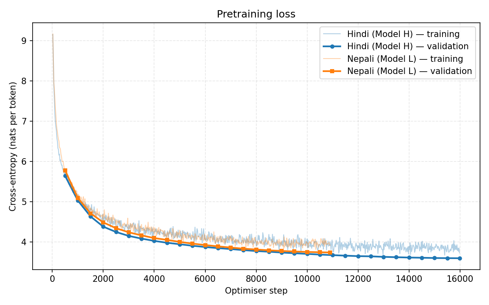

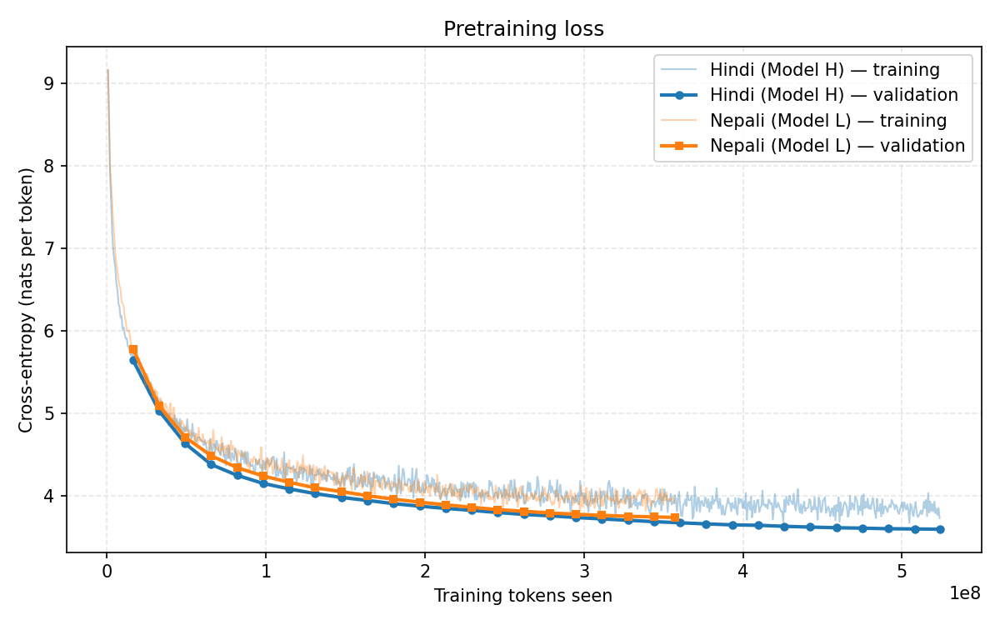

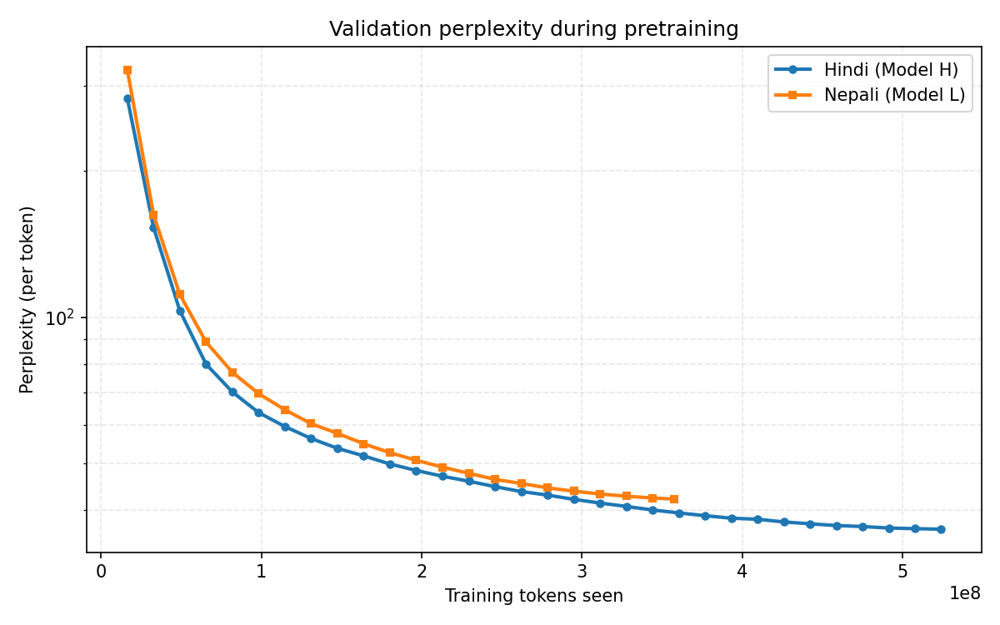

Two x-axes because they answer different questions. Against optimiser steps the models are compared at equal work, which isolates the architecture. Against tokens seen they are compared at equal data, which is the comparison the resource gap is about.

## 4. Language-modelling results

**Validation split.**

| Model | Cross-entropy (nats/token) | Perplexity | Bits per byte | Tokens scored |
|---|---|---|---|---|
| Hindi (Model H) | 3.7670 | 43.25 | 0.5607 | 5,245,952 |
| Nepali (Model L) | 3.8559 | 47.27 | 0.4488 | 3,685,888 |

**Test split.**

| Model | Cross-entropy (nats/token) | Perplexity | Bits per byte | Tokens scored |
|---|---|---|---|---|
| Hindi (Model H) | 3.7583 | 42.88 | 0.5568 | 5,324,288 |
| Nepali (Model L) | 3.8529 | 47.13 | 0.4482 | 3,573,760 |

**Perplexity cannot be compared across the two models; bits-per-byte can.** Perplexity is per token, and the two tokenizers are independent by construction, so a token is not the same amount of language in the two models. Bits-per-byte divides the same likelihood by the passage's size in UTF-8 bytes instead, which removes the tokenizer from the comparison.

**The two metrics disagree in direction, and that is the result.** Hindi (Model H) has the lower perplexity (42.88 against 47.13 on test), while Nepali (Model L) has the lower bits-per-byte (0.4482 against 0.5568). The arithmetic behind the flip is that Nepali (Model L)'s tokens carry 12.40 bytes against 9.74 -- 27.4% more text per token -- while its cross-entropy is only 2.5% higher. Dividing by bytes rather than tokens more than absorbs that gap.

Read carefully, this does not say the lower-resource model is the better model. The two are scored on *different text*, so the comparison is of how efficiently each encodes its own language, not of which would win on a shared benchmark. What it does establish is that the obvious reading of the perplexity column -- that the lower-resource model is clearly worse -- is an artefact of tokenizer granularity and does not survive a tokenizer-independent measure.

One caveat on the absolute values: both corpora are Devanagari, which UTF-8 encodes in three bytes per character with two of the three nearly determined by the first. Bits-per-byte is therefore mechanically low here -- roughly 1.67 and 1.34 bits per *character* -- and these figures should not be set beside published bits-per-byte for Latin-script English. Between these two models, which share a script, the comparison is sound.

## 5. Generation quality

| Model | Decoding | BLEU | chrF | ROUGE-L | Repetition (4-gram) | Distinct-1 | Distinct-2 |
|---|---|---|---|---|---|---|---|
| Hindi (Model H) | greedy | 3.58 | 15.81 | 0.104 | 0.779 | 0.111 | 0.189 |
| Hindi (Model H) | T=0.5 | 3.33 | 18.27 | 0.108 | 0.436 | 0.186 | 0.418 |
| Hindi (Model H) | T=1.0 | 2.29 | 21.69 | 0.101 | 0.004 | 0.499 | 0.932 |
| Hindi (Model H) | T=1.5 | 0.64 | 19.23 | 0.047 | 0.000 | 0.749 | 0.997 |
| Nepali (Model L) | greedy | 2.59 | 17.31 | 0.089 | 0.751 | 0.132 | 0.196 |
| Nepali (Model L) | T=0.5 | 2.15 | 22.31 | 0.104 | 0.258 | 0.305 | 0.538 |
| Nepali (Model L) | T=1.0 | 0.60 | 24.18 | 0.089 | 0.004 | 0.615 | 0.935 |
| Nepali (Model L) | T=1.5 | 0.20 | 21.93 | 0.035 | 0.000 | 0.813 | 0.996 |

**These metrics are weak evidence for open-ended generation, and that is worth stating plainly.** A prompt has many valid continuations; the test set contains one. n-gram precision against that single reference penalises a fluent-but-different continuation exactly as hard as gibberish, so BLEU here measures agreement with one arbitrary sample from the space of good answers rather than quality. They remain useful in one direction: they separate a model that has learned the language from one that has not, and they can be compared *between* Model H and Model L, which is the comparison this project is about.

**chrF is the most informative of the three here.** It matches character n-grams rather than whole words, so a correct stem with the wrong case ending earns partial credit. Hindi and Nepali agglutinate case and postposition markers onto stems, which makes word-level BLEU close to all-or-nothing per token in a way it is not for English. ROUGE-L sits between the two: its longest-common-subsequence rewards correct ordering without demanding adjacency.

Repetition rate and Distinct-1/2 are read together. High repetition with low distinctness is degeneration -- the model looping inside each sample. Low repetition with low distinctness means samples are varied internally but the model produces the same safe continuation for every prompt.

### 5.1 Generated samples

Held-out prompts from the test split, continued at temperature 1.0. The reference is what actually followed in the source document -- one valid continuation among many, which is the whole difficulty with scoring this task by overlap.

**Hindi (Model H)**

> **Prompt** ... होगी आधार योजना की प्रस्तुति सुसाइड से 20 मिनट पहले की थी बात केरल के सीएम विजयन को रामदेव ने दिया जवाब कहा बड़ा खुलासा! उपचार के दौरान ठप थे दरअसल, इस मैच में
>
> **Generated** उन्हें एंड बेस बैडमिंटन लड़ते हुए दिखाई देने चाहिए। हमले का डर रखती है इन लोगों की टीम मुंबई में कैम्पर्ट की जयपुर की गलियों में लगी आग घनी नजर आने वाली है। जहां पुलिस ये जानकारी जुटा रही है कि अल्पाइन की दवा लेने के... मिलते मजा नहीं आ रहा है Doविचार यह टिप्प...
>
> **Reference** ऑस्ट्रेलिया ने टॉस जीतकर पहले बल्लेबाजी करते हुए साउथ अफ्रीका को 434 रनों का विशाल लक्ष्य दिया। ऑस्ट्रेलिया ने 50 ओवर में सिर्फ 4 विकेट खोकर ही 434 रन बना दिए थे। ऑस्ट्रेलिया की ओर से कप्तान रिकी पॉन्टिंग ने शानदार 164 रनों की पारी खेली जबकि माइक हसी ने ताबड़त...

> **Prompt** ...है? PHP ईमेल सत्यापन कार्य एंड्रॉइड डाटाबेस लेनदेन आंतरिक वर्ग ऑब्जेक्ट से बाहरी कक्षा ऑब्जेक्ट को पकड़ना मैं कैसे अपने सी + + प्रोग्राम में हेडर फाइल <graphics
>
> **Generated** &apos;> सी + एकाधिक कुंजी कैसे प्राप्त करें <ogver / PHP के समान डेटाबेस कैसे प्राप्त करें? मैं कैसे अपनी Infidite इन्स्टॉल करना जारी रखता हूं? मैं बाएं पास इकोड अलगाव ड्रैगन के साथ तोड़ने वाला क्या है? मैं सिर्फ स्वयं को एक उपयोग (View शामिल है) में दूसरे विश...
>
> **Reference** .h> प्राप्त कर सकता हूं और उपयोग कर सकता हूं? IPhone पर कमजोर जोड़ने से काम करने से मना कर दिया PHP में एक तिथि बढ़ाने का सबसे आसान तरीका? MongoDB - व्यवस्थापक उपयोगकर्ता अधिकृत नहीं है Html पर नए टैब में लिंक कैसे खोलें? ORM का उपयोग करने के क्या फायदे हैं? M...

**Nepali (Model L)**

> **Prompt** ... छ । सोमबार राजधानीमा आयोजित कृतिको विमोचन समारोहसँगै यसमाथि बहस गरिएको हो । विमोचनपश्चात पत्रकार, लेखक दीपक सापकाले सहजीकरण गरेको विमर्श कार्यक्रममा बोल्दै कवि
>
> **Generated** डम्बर राईले गिर्जाघरले मानव ओराली गीतमा आफ्नो जात र केजी पूजा गर्ने तीज लगायत विविध विषयमा0क्रान्तिकारी समाज एकताबद्ध भएर अगाडि बढ्नुपर्ने बताए । चालु आर्थिक वर्षमा पनि दलित समुदायका दलित समुदायका १६१ जना दलित समुदाय र ८० प्रतिशत महिलाले कविता संग्रह 'मनीर' थर...
>
> **Reference** भूपाल राईले युद्धको 'आइडियोलोजी' आफू बाँच्नु रहेको बताए । 'युद्धको रुप र आयाम फरिन्छ, तर कुनै न कुनै रुपमा युद्ध भइरहेकै हुन्छ' राईले भने । उनले समकालीन नेपाली कविताको दुनियाँमा नरेशका कविता नयाँ विषय भएको बताए । साथै उनले नेपालमै पनि दश वर्षे जनयुद्धपछि आख्या...

> **Prompt** ...फामा न्तर्राष्ट्रिय बजारमा पेट्रोलियम पदार्थको मूल्य बढ्दा घाटामा गएको निगम अहिले फाइदामा गएको छ । स्वचालित मूल्य प्रणाली लागू गरेदेखि नेपाल आयल निगमले मासिक रु
>
> **Generated** ३७ लाख नाफामा खरिद बिक्री गरेको हो । निगमले ६ पटकसम्म इन्धन पायल्स डिजेल, चार लिटर तेल, एक लिटर पेट्रोल र चार लिटर डिजेल मूल्य वृद्धि गरेको थियो । ३० अर्ब गरेको त्यो बेलासम्म पेट्रोल प्रतिलिटर रु ३७ लाख २४ हजार ४७० र डिजेल ९४ हजार ४७१ मुल्य बृद्धि गरिएको निगमल...
>
> **Reference** ३४ करोड नाफा कमाएको छ । आज आयोजित नेपाल आयल निगम स्वतन्त्र कर्मचारी युनियनको दोस्रो केन्द्रीय महाधिवेशनका क्रममा सो कुराको जानकारी दिइएको हो । कार्यक्रममा बोल्दै नेपाली काँग्रेसका केन्द्रीय सदस्य तथा पूर्व उद्योगमन्त्री नवीन्द्रराज जोशीले पेसागत इमान्दारिता, क...

### 5.2 Qualitative notes on coherence and language correctness

**Greedy decoding degenerates into verbatim looping in both models.** The 4-gram repetition rate under greedy decoding is Hindi (Model H) 0.78, Nepali (Model L) 0.75, and the samples show what that number is: a single clause repeated until the token budget runs out. This is the expected behaviour of a 24M-parameter model at argmax, not a bug -- the most likely continuation of a sentence the model has already produced is that sentence again. It is also why the BLEU column peaks at greedy while chrF does not: repeated common n-grams collect precision credit that has nothing to do with quality.

**At temperature 1.0 the language itself is correct; the content is not.** Continuations are well-formed Devanagari with plausible morphology -- postpositions attach correctly, verb endings agree, native numerals are used consistently, and sentences terminate with a danda rather than trailing off. Byte-fallback artefacts are absent, which is consistent with the near-zero unknown rate Phase 1 measured. What fails is coherence beyond a clause or two: the models hold a register and a topic for roughly a sentence, then drift, and numeric and factual detail is confabulated freely -- a generated news continuation will keep the shape of a news report while inventing figures that contradict each other within the same sentence.

**Neither model shows a qualitative deficit relative to the other.** The failure modes are the same in kind and close in degree, which is the more informative comparison: the resource gap between Model H and Model L shows up as a small quantitative difference in held-out loss, not as one model having learned the language and the other not.

The honest summary is that both models have learned the *surface* of their language -- script, morphology, register, sentence shape -- and essentially none of the world knowledge or long-range planning that would make a continuation true or on-topic. At 24M parameters and one epoch over a few hundred million tokens, that is the expected outcome, and it is what the perplexity figures around 43 and 47 already imply.

## 6. Attention analysis

Three quantities per (layer, head), averaged over held-out text. Query position 0 is excluded from both averages: it can only attend to itself, so its entropy and distance are zero regardless of what the head learned.

**Normalised entropy** divides each head's entropy by the maximum available at that query position, `log(i+1)`. Near 1 means the head is doing little more than averaging over its context; near 0 means it has committed to specific tokens. **Mean attention distance** is how far back a query looks on average, in token positions: local or positional heads sit at one to three, content-based heads range further.

| Model | Layer | Mean normalised entropy | Mean distance | Sharpest head | Longest-range head |
|---|---|---|---|---|---|
| Hindi (Model H) | 0 | 0.878 | 88.7 | head 1 (0.810) | head 2 (141.8) |
| Hindi (Model H) | 1 | 0.850 | 83.3 | head 3 (0.721) | head 4 (160.4) |
| Hindi (Model H) | 2 | 0.733 | 102.4 | head 1 (0.618) | head 3 (202.0) |
| Hindi (Model H) | 3 | 0.478 | 52.3 | head 1 (0.377) | head 5 (220.1) |
| Hindi (Model H) | 4 | 0.458 | 7.6 | head 5 (0.291) | head 3 (15.2) |
| Hindi (Model H) | 5 | 0.338 | 7.6 | head 2 (0.027) | head 1 (19.0) |
| Hindi (Model H) | 6 | 0.347 | 45.4 | head 0 (0.087) | head 2 (180.0) |
| Hindi (Model H) | 7 | 0.438 | 73.0 | head 1 (0.273) | head 1 (178.9) |
| Hindi (Model H) | 8 | 0.552 | 100.6 | head 5 (0.349) | head 5 (158.7) |
| Hindi (Model H) | 9 | 0.678 | 80.6 | head 1 (0.557) | head 1 (119.4) |
| Nepali (Model L) | 0 | 0.893 | 93.2 | head 5 (0.795) | head 2 (138.7) |
| Nepali (Model L) | 1 | 0.859 | 91.5 | head 5 (0.705) | head 4 (150.2) |
| Nepali (Model L) | 2 | 0.770 | 88.2 | head 3 (0.656) | head 1 (209.9) |
| Nepali (Model L) | 3 | 0.516 | 46.5 | head 2 (0.380) | head 0 (218.5) |
| Nepali (Model L) | 4 | 0.483 | 7.0 | head 4 (0.391) | head 5 (9.6) |
| Nepali (Model L) | 5 | 0.293 | 4.5 | head 5 (0.021) | head 2 (9.2) |
| Nepali (Model L) | 6 | 0.375 | 30.2 | head 3 (0.262) | head 2 (122.0) |
| Nepali (Model L) | 7 | 0.567 | 31.8 | head 0 (0.459) | head 1 (58.1) |
| Nepali (Model L) | 8 | 0.575 | 75.0 | head 0 (0.440) | head 3 (116.8) |
| Nepali (Model L) | 9 | 0.662 | 64.9 | head 2 (0.604) | head 1 (71.5) |

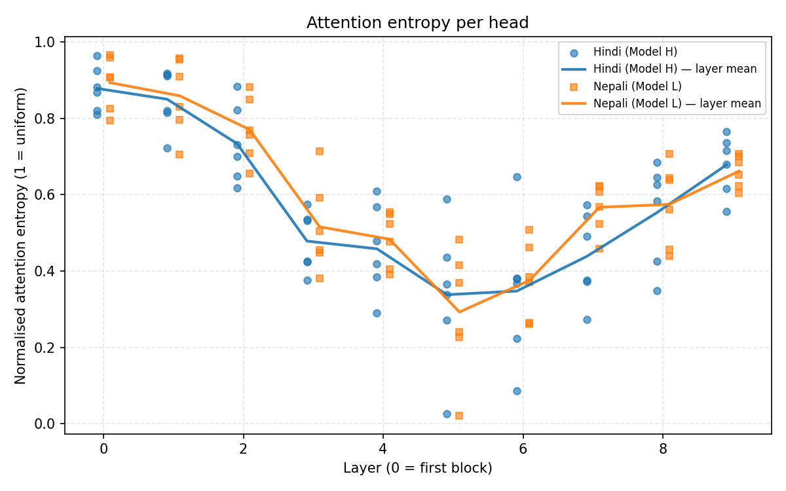

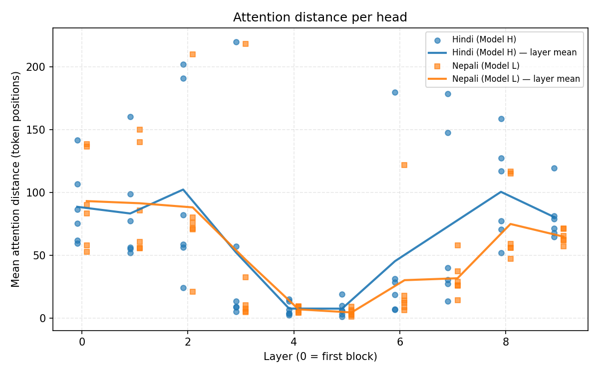

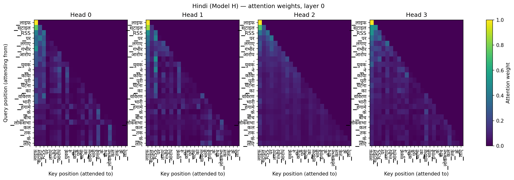

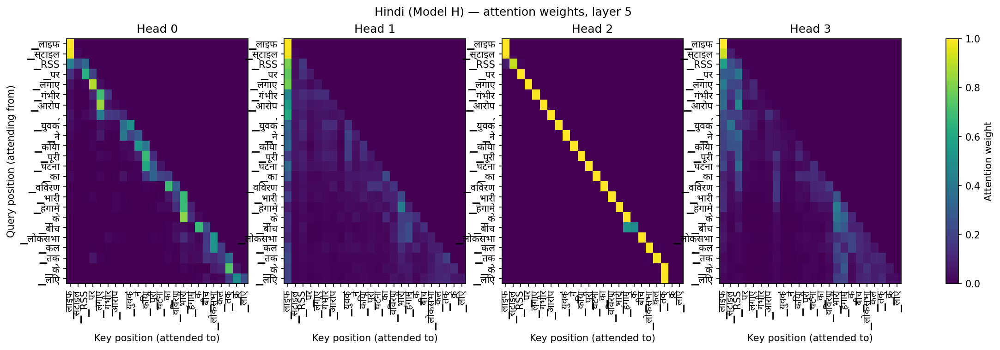

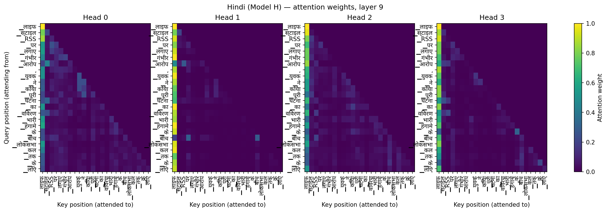

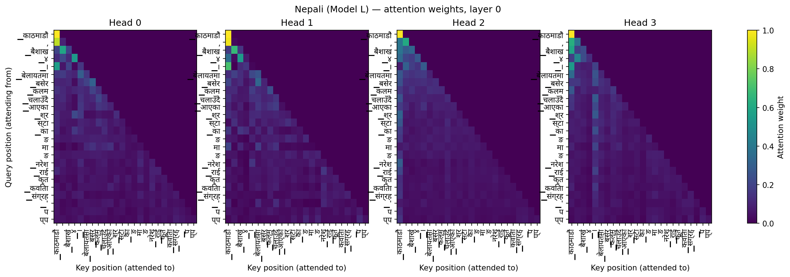

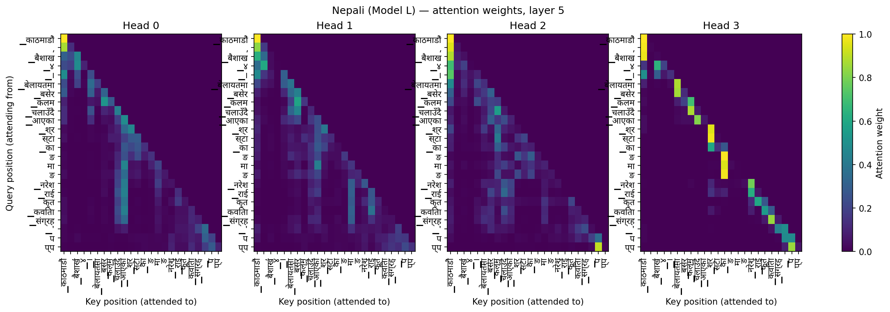

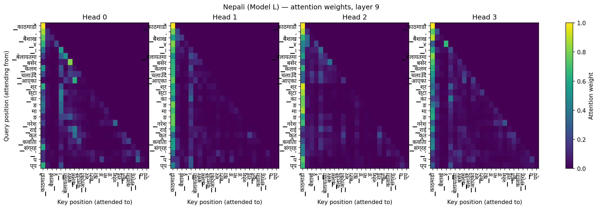

Every heatmap is lower-triangular by construction, which is the causal mask visible directly: a query at position *i* has zero weight on every key after it. A full square would mean the mask was broken.

## 7. Resource-level comparison

| | Hindi (Model H) | Nepali (Model L) |
|---|---|---|
| Training tokens | 524,524,486 | 358,339,370 |
| Tokens seen | 523,665,408 | 357,466,112 |
| Test perplexity | 42.88 | 47.13 |
| Test bits-per-byte | 0.5568 | 0.4482 |
| Bytes per token | 9.74 | 12.40 |
| Best chrF (any decoding) | 21.69 | 24.18 |

The corpora differ by a factor of 1.46 in training tokens, which is the resource gap this project is built to measure. Three things follow from the runs above.

**The gap splits almost evenly between corpus size and everything else.** At the point where Nepali (Model L) exhausts its corpus (357,466,112 tokens), Hindi (Model H) is at 3.6756 validation loss against 3.7410 -- a gap of 0.0654 nats that is *not* explained by data volume, since both models have seen the same number of tokens. Hindi (Model H) then gains a further 0.0772 nats from the 166,199,296 tokens it still has left. So roughly 46% of the final difference is present at equal data and 54% is bought by the larger corpus.

That matters for how the result is stated. Against optimiser steps the two models look nearly identical; against tokens seen they separate; and only the second axis reflects the resource gap the project is about. Neither axis alone tells the whole story, which is why both figures are included above.

**Tokenizer fertility compounds the gap.** Phase 1 measured 1.2823 tokens per word for Hindi (Model H) against 1.3687 for Nepali (Model L) at the same 16,000-entry vocabulary -- 6.7% higher. A tokenizer fitted on less text learns fewer useful subwords, so the same amount of language costs more tokens. The lower-resource language is therefore penalised twice over: there is less of it, and each token of it carries less linguistic content, so a fixed context window holds less actual text and a fixed token budget buys less training signal.

**The tokenizer is doing more work than the parameter count.** Both models are byte-for-byte the same architecture with the same 24,086,016 parameters and the same 16,000-entry vocabulary size, so every difference in the tables above comes from the data and the vocabulary fitted to it. The lower-resource language ends up with the coarser tokenizer -- more bytes per token -- which flatters its bits-per-byte and penalises its perplexity, in opposite directions.

**Generation separates them more clearly than perplexity does.** The overlap metrics are noisy, but the degeneration diagnostics are not: the repetition rate under greedy decoding is high for both models, which is the expected failure of a 24M-parameter model asked to continue open-ended text, and it falls away as temperature rises. That both models show the same shape, at similar magnitudes, is itself evidence that the resource gap has not produced a qualitatively different model -- only a slightly weaker one.

## 8. Reproduction

See the repository `README.md` for the full command sequence and the Google Drive links to the checkpoints.

